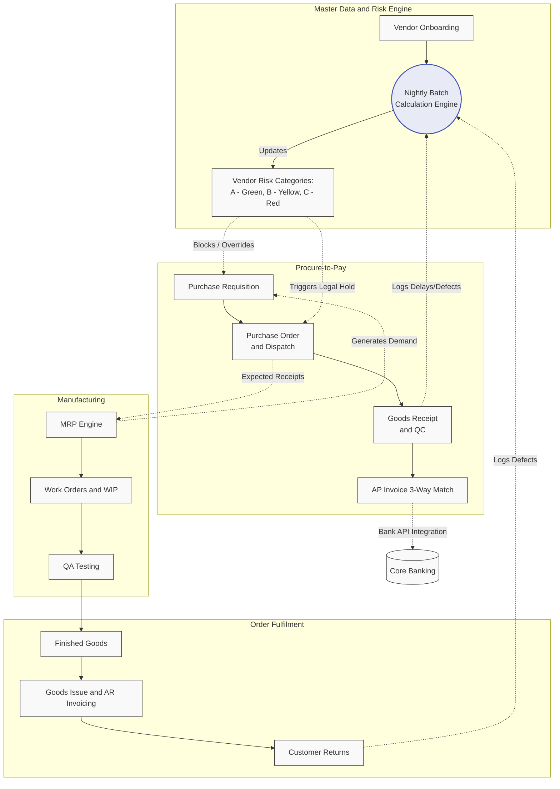

# Master Business Requirements Document (BRD)
**Project:** Enterprise ERP Implementation (P2P, Manufacturing, Order Fulfillment)
**Version:** 1.2 (Includes A/B/C Vendor Risk Management & System Integrations)

## 1. Executive Summary
This document outlines the end-to-end architectural and functional requirements for a comprehensive ERP ecosystem. The design prioritises strict Separation of Duties (SoD), financial compliance (SOX, IFRS 15), automated Material Requirements Planning (MRP), rigorous End-to-End Lot/Batch Traceability, and an event-driven Vendor Risk Management engine to secure the supply chain, from raw material procurement to final customer dispatch and returns..

## 2. System Architecture & Core Principles
*   **Separation of Duties (SoD):** Strict role compartmentalisation preventing any single user from initiating and approving critical transactions (e.g., Procurement vs. AP, Warehouse vs. QA).
*   **Automated Risk Management (A/B/C Categories and Batch Engine):** Vendors are dynamically labelled (Green, Yellow, Red) by a nightly Batch Calculation Engine based on historical defect and delay events. The system automatically enforces manual overrides for Yellow vendors and orchestrates a complete supply chain blockade (Legal Holds and orphaned demand rerouting) for Red vendors.
*   **Clean Invoice & 3-Way Match:** Strict matching logic ensuring physical receipts match financial liabilities, with automated Purchase Price Variance (PPV) tolerances and documented Compliance Overrides for quarantined stock.
*   **Revenue Recognition Compliance:** Accounts Receivable (AR) invoices are generated strictly upon Goods Issue (IFRS 15).
*   **Segregated Inventory Visibility:** Defective or quarantined items are systematically hidden from the shop floor and dispatch workers to prevent accidental consumption.

## 3. High-Level Ecosystem Diagram

## 4. Module Hierarchy & Process Flow
The system is divided into seven sequential operational modules. 

### Phase 1: Foundation & Master Data
*   **01. System Setup:** AP/Procurement Approval Matrices and System Roles definition for SoD enforcement.
*   **02. Master Data Management (MDM):** 
    *   Item Creation routing with Min/Max limits.
    *   Vendor Onboarding (Tax/IBAN validation) and continuous Batch Engine risk assessments.
    *   Customer Onboarding (KYC legal review and Financial Credit Limits).

### Phase 2: Procure-to-Pay (P2P)
*   **03. Procurement Execution:** Manual and MRP-triggered Requisitions, Vendor Risk Gateways blocking Red vendors, Umbrella Contract management, and PO dispatch.
*   **04. Logistics & Quality Control:** Goods Receipt via barcode scanning, delivery delay calculations, and Quarantine routing with Legal Hold Compliance Override handling.
*   **05. AP Financial Execution:** 3-Way Match logic, discrepancy handling (Price Holds), auto-propagated legal resolutions for audits, and automated Bank API payment integrations.

### Phase 3: Build, Fulfill & Support
*   **06. Manufacturing:** Multi-stage production routings (WIP), Lot/Batch traceability locking, QA rework loops, and threshold-based financial Scrap write-offs. MRP calculates demand excluding Legal Hold POs.
*   **07. Order Fulfilment & Sales:** 
    *   Make-to-Stock, Make-to-Order, and R&D pipelines. 
    *   Flexible barcode picking and Goods Issue-triggered AR Invoicing.
    *   **Customer Returns (RMA):** Inbound logistics for returns, AR Credit Memo generation, and Traceability queries tracking defects back to the Historical Data Schema for vendor penalty calculation.

### Phase 4: Analytics & Intelligence
*   **08. Reporting & Analytics:** Operational dashboards, reporting specifications, and QA/R&D outcome tracking.

### Phase 5: System Integrations
*   **09. System Integrations & Interfaces (Outbound AP Payments):**
    *   **REST API & Webhooks:** Secure API integration to Bank Gateways for releasing approved batches.
    *   **Idempotency & State Management:** Asynchronous webhook endpoints built with idempotency keys (Transaction_ID + Status) to prevent duplicate execution from network retry loops.

## 5. Master Data Elements
*   **Items/SKUs:** Categorised with dynamic thresholds for automated MRP.
*   **Vendors:** Evaluated dynamically via the Batch Calculation Engine (A/B/C ratings).
*   **Customers:** Governed by hard Credit Limits and historical risk dossiers.
*   **Lot/Batch:** The central tracking entity linking Vendor POs, Manufacturing Work Orders, Sales Orders, and RMAs.
*   **Historical Data Schema:** An event-sourced ledger tracking all delays and defects for auditability.

## 6. Master User Stories Backlog
*(Note: A complete list of agile user stories is appended to the bottom of each respective module's markdown file, ensuring requirements are kept adjacent to their business logic.)*

---
**Approval & Sign-off:**
*   **Business Analyst / Product Owner:** [Viktoriia Ovcharenko]
*   **System Architect:** [TBD]
*   **Finance Controller:** [TBD]

