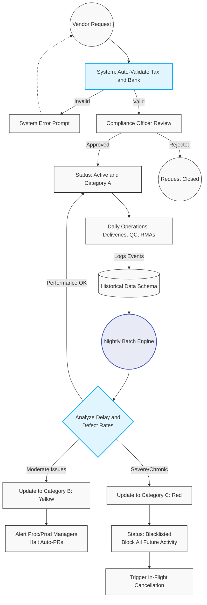

# 202. Vendor Onboarding, Master Data & Risk Management

## 1. Business Context
The Vendor Onboarding process is triggered after the Sourcing/RFQ phase is successfully concluded. To ensure compliance and data integrity, the system utilises an automated validation gateway for financial data (Tax ID, Bank formats) before routing the request and mandatory legal attachments for manual human approval (Compliance/Legal). Once active, vendors are subjected to continuous automated risk assessment via a daily Batch Calculation Engine.

## 2. Business Process Flow: Vendor Registration & Activation

**Primary Actors:** Procurement Manager (Initiator), System, Compliance Officer.

### Process Steps:
1. **Initiation:** The Procurement Manager opens the *Vendor Management* module and creates a "New Vendor Request".
2. **Data Entry:** The Initiator populates mandatory enterprise fields (Legal Name, Tax ID, IBAN, SWIFT/BIC, Payment Terms).
3. **Document Upload:** The Initiator attaches mandatory scan-copies of legal documents.
4. **Automated System Validation:** The ERP system automatically validates the formatting and checksums of the entered Tax ID and Bank Details.
    *   *Exception:* If the format is invalid, the system instantly rejects the submission and prompts the Initiator to correct the data.
5. **Submission & Routing:** If system validation passes, the request is routed to the Compliance department (Status: **[Pending Compliance]**).
6. **Compliance Review:** The Compliance Officer reviews the data and verifies attached documents against external sanction lists.
7. **Activation:** The system creates the Vendor Master Record (Status: **[Active]**) and sets the initial Vendor Rating to Category A (Green).

---

## 3. Vendor Performance & Risk Labelling Engine

The ERP employs a daily **Batch Calculation Engine** (CRON Job running overnight) to dynamically assess vendor reliability. The engine scans all Goods Receipts and AP Invoices to calculate delivery delays, QC defect rates, and invoice discrepancies. All triggered events are permanently logged in the **Historical Data Schema** for auditability.

### 3.1 Vendor Risk Categories
*   **Category A (Green - Good Vendor):** Standard touchless procurement and automated PR generation are enabled.
*   **Category B (Yellow - Potential Risk):** Triggered by moderate delays or defects. 
    *   *System Action:* Disables auto-catalogue PR creation. Sends notifications to the Procurement Manager (to source alternatives) and Production Manager (flagging product risk). Overrides approval matrices for forced orders.
*   **Category C (Red - Risky Vendor):** Triggered by severe or chronic failures.
    *   *System Action:* Instantly updates the vendor's Master Data status to **[Inactive/Blacklisted]**. Blocks creation of all new PRs and POs. Triggers the Cancellation Workflow for in-flight documents.

---

## 4. Workflow Diagram

---

## 5. Key User Stories

*   **US-VEN-01:** As the System, I want to automatically validate the format and checksum of Bank Details and Tax IDs upon submission, catching invalid data without human intervention.
*   **US-VEN-02:** As a Compliance Officer, I want to view the attached scan-copies directly within the vendor request, so that I can efficiently verify the legal authenticity of the supplier.
*   **US-MDM-01:** As the System, I want to execute a daily batch calculation to analyse delivery delays and defect rates, dynamically updating the Vendor's A/B/C risk label based on historical performance data.
*   **US-MDM-02:** As the System, I want to immediately change a vendor's status to [Inactive/Blacklisted] when their rating falls to Category C (Red), removing them from all active procurement dropdown menus.
*   **US-MDM-03:** As an Auditor, I want to query the Historical Data Schema to view every individual supply chain event (e.g., late deliveries, QC defects) that contributed to a vendor's current risk label.
