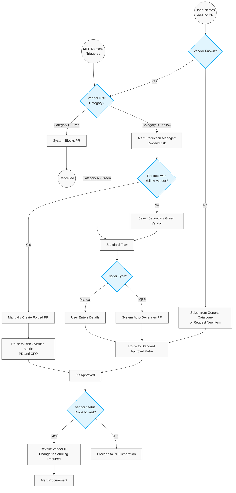

# 301. Purchase Requisition (PR) Management

## 1. Prerequisites (System Setup & Data)
Before a Purchase Requisition can be successfully initiated and routed, the following system configurations and master data migrations must be completed.

### 1.1. Security & Role Setup
*   **Production Manager:** Granted permissions to create Purchase Requisitions (PR) and initiate "Item Creation" requests.
*   **Item Admin / MDM:** Granted permissions to create, update, and manage Item Master Data.
*   **Procurement Manager:** Granted permissions to create and manage Vendors, Contracts, and Purchase Orders (PO).

### 1.2. Master Data & Financial Setup
*   **Organizational Structure:** Employee list uploaded with reporting hierarchies.
*   **Workflow:** Procurement Approval Matrix configured in the system (including Risk Overrides).
*   **Vendor Risk Data:** Vendor A/B/C categorisations actively maintained by the MDM Batch Engine.
*   **Catalogs:** Initial upload of Item Master Data, Vendors, and Contracts.
*   **Cutover Data (Migration):** Upload of historical/open data, including open PRs, open POs, on-hand inventory, and Work-in-Progress (WIP) inventory.

---
## 2. Business Process Flow: Create Purchase Requisition

**Primary Actors:** Production Manager (Requestor), System (MRP), Procurement Manager.
**Trigger:** Need for materials (Part X) for the manufacturing process.

**Trigger Gateway (Manual vs. Automated based on Risk Label):**
*   **Automated (MRP/Min-Max - Category A Vendors Only):** For standard catalogue components linked to a Category A (Green) vendor, the MRP engine continuously monitors stock levels. When inventory drops below the predefined Minimum Stock threshold, the system automatically generates a PR.
*   **Manual (Ad-Hoc or Category B Vendors):** The Production Manager manually initiates a PR for non-standard requirements. Additionally, if the MRP detects a shortage for a Category B (Yellow) vendor, it halts automation and alerts the PM to manually initiate the PR or route the demand to a Secondary Vendor.
*   **Blocked (Category C Vendors):** No PRs can be generated for Category C (Red) vendors. 

### Process Steps:
1. **Initiation:** The Requestor navigates to the *Requisitions* module and selects *Create Requisition*.
2. **Vendor & Contract Selection:**
    *   *Known Source:* The Requestor selects an existing Vendor and Contract. (Restricted to Active, non-Red vendors).
    *   *Unknown Source:* The Requestor leaves these fields blank. (Bypasses initial Risk Gate, triggers Sourcing later).
3. **Item Selection:**
    *   Choose the item directly from the specific Vendor’s catalogue or general Item Master.
    *   *Exception:* Initiate **Item Creation Request** if the part is missing.
4. **Submission & Routing:** The Requestor populates remaining details (quantity, required date), clicks *Send for Approval*. The system evaluates the PR value and Vendor Risk category, routing it based on the Procurement Approval Matrix.
5. **Exception Handling (Orphaned Demand):** If an active PR's linked vendor is downgraded to Category C (Red) before the PO is dispatched, the system automatically revokes the vendor, changes the PR status to **[Sourcing Required]**, and alerts the Procurement Manager to find a new supplier.

---

## 3. Workflow Diagram

---

## 4. Key User Stories

*   **US-PR-01:** As the System, I want to automatically generate a Purchase Requisition when an active item's stock falls below the minimum threshold, provided the primary vendor is Category A (Green).
*   **US-PR-02:** As the System, I want to block auto-generation of PRs for Category B (Yellow) vendors and instead notify the Production Manager to manually manage the risk.
*   **US-PR-03:** As a Procurement Manager, I want the system to automatically flag in-flight PRs as [Sourcing Required] if the vendor turns Red, so that I can immediately assign a new supplier without losing the manufacturing demand.
*   **US-PR-04:** As a Production Manager, I need the ability to trigger an "Item Creation Request" directly from the PR screen if a part is missing, so that I don't have to navigate to a different module.
*   **US-PR-05:** As a Production Manager, I want to manually create an ad-hoc Purchase Requisition without selecting a vendor, so that the Procurement department can source the best supplier for my requirement.
