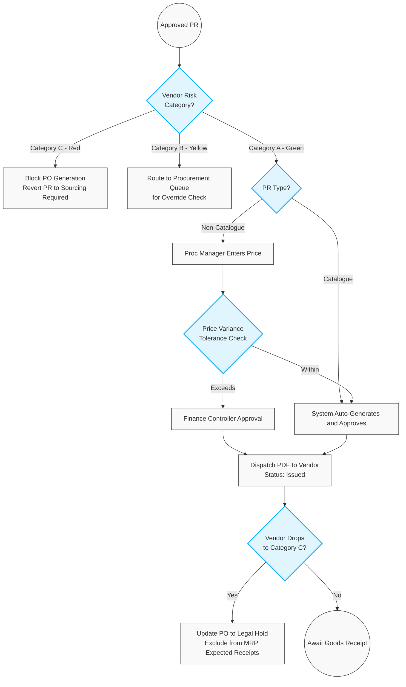

# 303. Purchase Order (PO) Execution & Risk Mitigation

## 1. Business Context
The Purchase Order (PO) generation process integrates closely with the Master Data Management (MDM) Vendor Risk Labelling system (Categories A, B, and C). The system attempts to achieve "Touchless Procurement" for standard catalogue items, but strictly enforces manual intervention, Split Sourcing, and hierarchical approvals the moment a vendor's performance rating deteriorates.

## 2. Business Process Flow: PO Creation & Vendor Risk Gateways

**Primary Actors:** System, Procurement Manager, Production Manager, Legal/Compliance.

### Process Steps:

**Pre-Condition (Vendor Risk Gateway):**
Before any PR converts to a PO, the system evaluates the vendor's active risk label:

*   **Category A (Green):** Proceed to standard PO generation.
*   **Category B (Yellow):** Auto-catalogue PR generation is halted. The system alerts the Production Manager, who must decide whether to proceed with the Yellow vendor (requires Production Director & CFO approval) or utilise a Secondary Vendor. A separate alert is routed to Procurement to begin sourcing alternatives.
*   **Category C (Red):** The system completely blocks the creation of all new PRs and POs.

### 2.1 In-Flight Reversals & Cancellation (Red Vendor Trigger)
If a vendor's rating drops to Category C (Red) while procurement documents are already in progress, the system executes an automated containment protocol:
1.  **Open PRs & Unsent POs:** The system automatically cancels these documents, revokes the Red vendor's ID, and reverts the demand to a **[Sourcing Required]** status. An alert is sent to the Procurement Manager to action the orphaned demand.
2.  **Dispatched POs (State 3):** Since sent POs represent legal offers, they are automatically transitioned to a **[Legal Hold]** status. This temporarily removes the expected volume from the MRP engine's calculations and alerts the Legal/Procurement team to initiate formal contract cancellation procedures offline.

### 2.2 Standard Workflow (Post-Risk Check)
1.  **Routing Gateway (Catalogue vs. Non-Catalogue):**
    *   *Catalogue PR:* The system auto-generates the PO using fixed contract prices.
    *   *Non-Catalogue PR:* The Procurement Manager enters current ad-hoc pricing and links it to an Umbrella Contract.
2.  **Variance Check (Non-Catalogue Only):** The system checks the new price against the contract's Price Variance tolerance and checks the Total Remaining Contract Value.
    *   *Within Limits:* The PO is automatically approved.
    *   *Exceeds Limits:* The PO is routed to the Finance Controller for secondary approval.
3.  **Dispatch:** Once the PO is approved (automatically or manually), the system generates a standard PDF and automatically dispatches it to the Vendor's registered email address (or via EDI). Status updates to **[Issued to Vendor]**.

---

## 3. Workflow Diagram

---

## 4. Key User Stories

*   **US-PO-01:** As the System, I want to auto-generate and dispatch POs for Catalogue PRs linked to Category A (Green) vendors, enabling touchless procurement.
*   **US-PO-02:** As the System, I want to halt automatic PR creation for Category B (Yellow) vendors and notify the Production Manager, forcing a conscious decision to accept risk or route to a secondary supplier.
*   **US-PO-03:** As the System, I want to instantly revert any open PRs and unsent POs to [Sourcing Required] if the linked vendor drops to Category C (Red), preventing risky commitments.
*   **US-PO-04:** As the System, I want to transition dispatched POs for Red vendors into a [Legal Hold] status, ensuring the MRP engine does not rely on those goods while Legal negotiates cancellation.
*   **US-PO-05:** As the System, I want to automatically check Non-Catalogue POs against the contract's Price Variance limit, routing exceptions to Finance while auto-approving those within tolerance.
