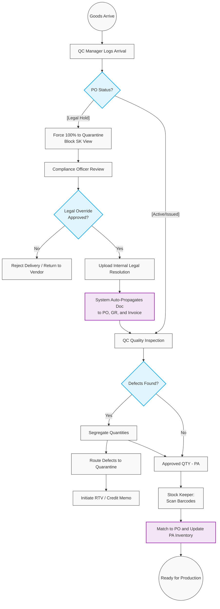

# 401. Goods Receipt, Quality Control (QC) & Compliance Overrides

## 1. Business Context
The receiving process ensures that only high-quality materials enter the production inventory. It employs strict Separation of Duties (SoD) between the Quality Control (QC) Manager (who inspects quality) and the Stock Keeper (who scans barcodes for inventory putaway). This module also handles critical edge cases, such as "Ghost Deliveries" arriving from legally suspended vendors, ensuring uncompromising financial and legal control.

## 2. Business Process Flow

**Primary Actors:** QC Manager, Stock Keeper, Compliance Officer, System.

### Process Steps:
1. **Delivery Arrival & Delivery Validation (QC Manager):**
    *   The QC Manager logs the arrival against the PO. The system calculates delivery delays (calendar/working days) to feed into the nightly Vendor Rating Batch Engine.
2. **The "Ghost Delivery" / Legal Hold Exception:**
    *   If a truck arrives for a PO that is currently in **[Legal Hold]** (due to a Category C Red Vendor rating), the standard receiving process is interrupted.
    *   The QC Manager is permitted to unload the truck, but the system forces 100% of the goods into **[Quarantine]**. The Stock Keeper is blocked from scanning these goods into Production Available (PA) stock.
    *   *Compliance Override:* To utilise these goods, the Compliance Officer must execute a system override to release the `[Legal Hold]`. This action strictly requires a mandatory file upload (Internal Legal Resolution).
    *   *Auto-Propagation:* Once uploaded, the system automatically duplicates and attaches this legal resolution to the PO, the Goods Receipt, and the downstream AP Invoice to satisfy external audit requirements.
3. **Quality Inspection & Segregation (QC Manager):**
    *   For standard active POs, the QC Manager inspects the goods and records the quantities of "Good" vs. "Defected" items.
    *   Defective items are systematically moved to a virtual **[Quarantine]** location.
    *   *System Action:* The defect quantity is logged to feed into the nightly Vendor Rating Batch Engine.
4. **Goods Receipt & Inventory Putaway (Stock Keeper):**
    *   The Stock Keeper accesses the receiving module. The system securely hides any quarantined/defective quantities.
    *   The Stock Keeper scans the barcodes of the approved items (Production Available amount). The system captures the exact date and time of scanning.
    *   The system links the Goods Receipt (GR) document to the original PO and updates the active inventory.
5. **Return to Vendor (RTV):**
    *   For defective items in Quarantine, the QC Manager initiates a Return to Vendor (RTV) transaction.
    *   The system generates a Credit Memo request to reverse the financial liability for the defective parts.

---

## 3. Workflow Diagram

---

## 4. Key User Stories

*   **US-QC-01:** As a QC Manager, I want to segregate received items into "Good" and "Defective" quantities, routing defects directly to a Quarantine location.
*   **US-QC-02:** As the System, I want to force all goods arriving under a [Legal Hold] PO directly into Quarantine, ensuring risky deliveries cannot enter the production line automatically.
*   **US-COMP-01:** As a Compliance Officer, I want to be able to release a [Legal Hold] on a quarantined delivery only by uploading a mandatory internal legal resolution document.
*   **US-SYS-02:** As the System, I want to automatically propagate and attach the Compliance Officer's uploaded legal resolution to the Goods Receipt and AP Invoice, providing AP Accountants with immediate audit context.
*   **US-SK-01:** As a Stock Keeper, I want the system to completely hide quarantined or [Legal Hold] inventory from my receiving queue, preventing accidental putaway of unapproved goods.
