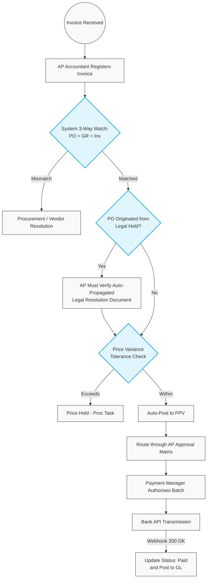

# 501. AP Invoice Matching & Payment Execution

## 1. Business Context
The Accounts Payable (AP) process ensures strict financial compliance through a rigorous 3-Way Match logic (Purchase Order = Goods Receipt = Invoice). It enforces a clear Separation of Duties (SoD) between Warehouse logistics, AP Accounting, and Treasury (Payment Managers). The system accommodates standard price tolerances via Purchase Price Variance (PPV) accounts, routes discrepancies for procurement resolution, and handles exceptional compliance overrides for quarantined goods arriving from Category C (Red) vendors.

## 2. Business Process Flow

**Primary Actors:** AP Accountant, System, Procurement Manager, Payment Manager.

### Process Steps:
1. **Invoice Registration (AP Accountant):**
    *   The AP Accountant enters the physical/electronic invoice into the system (Status: **[Initiated/New]**) and links it to the corresponding PO and Goods Receipt.
2. **Systematic 3-Way Match & Variance Handling:**
    *   **Quantity Match:** The system verifies Invoice Quantity against Receipt Quantity. If the Invoice bills for more than received, the system blocks processing.
    *   **Compliance Match Override:** If the Goods Receipt originated from a Category C (Red) vendor whose PO was on `[Legal Hold]`, the system requires the AP Accountant to explicitly verify the auto-propagated *Internal Legal Resolution* document before the match can be finalised.
    *   **Price Match & Tolerance:** The system compares the Invoice Price to the PO Price. 
        *   *Within Tolerance:* Minor deviations are allocated to a PPV account.
        *   *Out of Tolerance:* The invoice is placed on **[Price Hold]**. A task is routed to the Procurement Manager to resolve the discrepancy with the vendor.
3. **PO Balance Management (Close Short):**
    *   For partial deliveries, if the vendor will not supply the remaining balance, the Procurement Manager executes a **Close Short** action to release committed funds and permanently record the vendor's failure to deliver.
4. **Financial Approval:**
    *   Successfully matched invoices enter the AP Approval Matrix based on the total payment amount and cost center.
5. **Payment Execution (Payment Manager):**
    *   Approved invoices are queued for payment. The Payment Manager reviews the batch and authorises the fund release.
    *   The system transmits instructions to the bank via API. Upon bank confirmation via webhook, the invoice status updates to **[Paid]** and the system posts the final entries to the General Ledger (GL).

---

## 3. Workflow Diagram

---

## 4. Key User Stories

*   **US-AP-01:** As an AP Accountant, I want to link a new invoice to an existing PO and Goods Receipt for automated 3-Way Matching.
*   **US-AP-02:** As an AP Accountant, I want to have direct access to the auto-propagated *Internal Legal Resolution* document when matching an invoice from a Red vendor, ensuring I have full audit context before authorising the financial liability.
*   **US-AP-03:** As the System, I want to automatically allocate minor invoice price discrepancies to a PPV account based on predefined tolerance rules, so that minor rounding issues do not halt the payment process.
*   **US-AP-04:** As a Procurement Manager, I want the ability to perform a "Close Short" on a partially fulfilled PO, so that unused budget is released and the vendor's failure to deliver the full quantity is permanently recorded.
*   **US-FIN-01:** As a Payment Manager, I want to authorise approved invoice batches for payment, allowing the system to securely transmit instructions to the bank via REST API.
