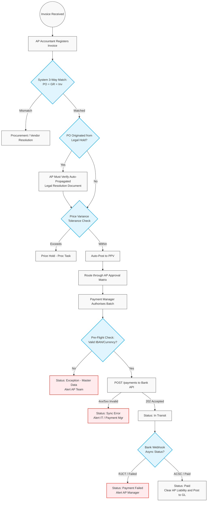

# 501. AP Invoice Matching & Payment Execution

## 1. Business Context
The Accounts Payable (AP) process ensures strict financial compliance through a rigorous 3-Way Match logic (Purchase Order = Goods Receipt = Invoice). It enforces a clear Separation of Duties (SoD) between Warehouse logistics, AP Accounting, and Treasury (Payment Managers). 

For payment execution, the system employs a robust API integration with the Core Banking system. This includes pre-flight validation, synchronous payload handshakes, and asynchronous webhook handling (with idempotency) to gracefully manage unhappy paths such as invalid master data, API timeouts, or insufficient funds.

## 2. Business Process Flow

**Primary Actors:** AP Accountant, System, Procurement Manager, Payment Manager.

### Process Steps:
1. **Invoice Registration (AP Accountant):**
    *   The AP Accountant enters the physical/electronic invoice into the system (Status: **[Initiated/New]**) and links it to the corresponding PO and Goods Receipt.
2. **Systematic 3-Way Match & Variance Handling:**
    *   **Quantity Match:** The system verifies Invoice Quantity against Receipt Quantity. If the Invoice bills for more than received, the system blocks processing.
    *   **Compliance Match Override:** If the Goods Receipt originated from a Category C (Red) vendor whose PO was on `[Legal Hold]`, the system requires the AP Accountant to explicitly verify the auto-propagated *Internal Legal Resolution* document before the match can be finalised.
    *   **Price Match & Tolerance:** The system compares the Invoice Price to the PO Price. Minor deviations are allocated to a PPV account; major deviations trigger a **[Price Hold]**.
3. **PO Balance Management (Close Short):**
    *   For partial deliveries, the Procurement Manager executes a **Close Short** action to release committed funds.
4. **Financial Approval:**
    *   Successfully matched invoices enter the AP Approval Matrix.
5. **Payment Execution & Edge Case Handling (Payment Manager & System):**
    *   **Pre-Flight Check:** Before queueing the API payload, the system verifies the vendor's active IBAN/SWIFT and currency match. If invalid, the invoice is flagged as **[Exception: Master Data]** and halted.
    *   **Transmission (Synchronous Phase):** The Payment Manager authorises the batch. The system transmits a `POST /payments` payload to the bank.
        *   *Unhappy Path (4xx/5xx):* Invalid payload format. The system triggers an alert for the Payment Manager/IT.
        *   *Happy Path (202 Accepted):* The bank confirms schema validity. Invoice status updates to **[In Transit]**.
    *   **Asynchronous Settlement (Webhook Phase):** The bank processes the funds and pushes a webhook payload back to the ERP.
        *   *Unhappy Path (RJCT - Failed):* E.g., Insufficient funds (NSF) or blocked accounts. The ERP catches the webhook, updates status to **[Payment Failed - Review Required]**, and routes a high-priority task to the AP Manager.
        *   *Happy Path (ACSC - Paid):* The funds successfully settle. Status updates to **[Paid]**, and the system clears the AP sub-ledger to the General Ledger (GL).

---

## 3. Workflow Diagram

---

## 4. Key User Stories

*   **US-AP-01:** As an AP Accountant, I want to link a new invoice to an existing PO and Goods Receipt for automated 3-Way Matching.
*   **US-AP-02:** As an AP Accountant, I want to have direct access to the auto-propagated *Internal Legal Resolution* document when matching an invoice from a Red vendor.
*   **US-FIN-01:** As a Payment Manager, I want to authorise approved invoice batches for payment, allowing the system to securely transmit instructions to the bank via REST API.
*   **US-FIN-02:** As the System, I want to execute a Pre-Flight validation check on the vendor's IBAN, SWIFT, and Currency settings before generating the API payload, routing exceptions back to AP to prevent bank rejections.
*   **US-FIN-03:** As an AP Manager, I want to receive an immediate system alert if the Bank's asynchronous webhook returns a 'RJCT (Failed)' status, so I can rapidly resolve insufficient funds or frozen account holds.
