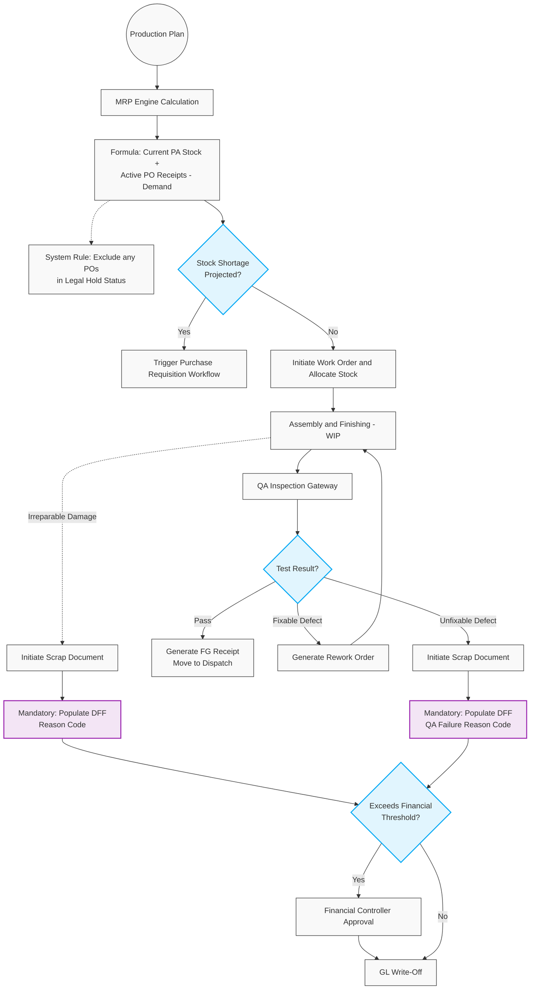

# 601. Manufacturing Execution & Quality Assurance

## 1. Business Context
The Manufacturing module is driven by a **Production Plan (Master Production Schedule - MPS)**. To prevent production downtime, the system utilises Material Requirements Planning (MRP) logic: it continuously monitors inventory levels against the Production Plan. 

Crucially, the MRP engine maintains a strict, real-time view of the supply chain. When calculating "Production Available" (PA) stock and expected inbound receipts, the MRP engine explicitly **excludes any Purchase Orders in a [Legal Hold] or [Pending Cancellation] status** (e.g., due to a Category C Vendor downgrade). This ensures the system immediately recognizes supply chain gaps and recommends new PRs for safe vendors.

Once materials are secured, production transforms raw materials into Finished Goods (FG) utilising multi-stage routings, ensuring End-to-End Lot Traceability. QA Engineers or Production Managers can initiate Scrap documents for defects, subject to financial approval. To ensure accurate downstream reporting and BI dashboards, all Scrap documents mandate the population of **Descriptive Flexfields (DFF)** with standardised Reason Codes.

## 2. Business Process Flow

**Primary Actors:** Production Manager, QA Engineer, Financial Controller, System (MRP).

### Process Steps:
1. **Production Planning & Automated MRP:**
    *   The Production Manager defines the long-term **Production Plan**.
    *   *Automated MRP Check:* The system calculates required BOM components. It calculates: `(Current PA Stock) + (Expected Active PO Receipts) - (Production Plan Demand)`. POs on `[Legal Hold]` are excluded.
    *   If projected stock falls below the critical threshold, the system triggers alerts and auto-generates PRs (for Category A vendors) or sends manual initiation alerts (for Category B vendors).
2. **Initiation & Allocation:**
    *   The Production Manager creates a **Production Work Order (WO)** based on the BOM and multi-stage Routing. The system allocates PA stock and securely locks Lot/Batch traceability.
3. **Multi-Stage Execution (WIP):**
    *   Components are consumed through stages (e.g., Assembly, Finishing). 
    *   If damaged items trigger a **Scrap Document**, the Production Manager is forced by the system to populate a mandatory **DFF** with the specific root-cause Reason Code (e.g., "Machine Calibration Error", "Material Breakage").
4. **QA Testing Gateway:**
    *   Upon routing completion, the status updates to **[In Testing]**. The QA Engineer evaluates the output.
5. **Outcome Routing:**
    *   *Scenario A (Pass):* The batch is approved. System generates an FG Receipt. Status: **[Completed]**.
    *   *Scenario B (Rework):* QA identifies fixable defects. A **Rework Order** returns units to WIP.
    *   *Scenario C (Scrap):* QA initiates a **Scrap Document** for unfixable defects. The QA Engineer must populate the mandatory **DFF Reason Code** detailing why the batch failed testing (vital for R&D and QA analytics).
6. **Financial Scrap Approval:**
    *   Scrap Documents exceeding predefined financial limits route to the Financial Controller for write-off approval.

---

## 3. Workflow Diagram

---

## 4. Key User Stories

*   **US-MRP-01:** As the System, I want to continuously monitor inventory levels against the Production Plan, sending critical low-stock alerts to Production and Procurement Managers before a line stoppage occurs.
*   **US-MRP-02:** As the System, I want to exclude any Purchase Orders with a [Legal Hold] or [Pending Cancellation] status from expected inbound inventory calculations, ensuring the MRP engine accurately identifies supply gaps caused by Red vendors.
*   **US-MFG-01:** As a Production Manager, I want the Work Order to follow a multi-stage routing path, so that I can track work-in-progress accurately.
*   **US-MFG-02:** As a Production Manager, I want to initiate a Scrap Document during assembly for parts that break, so that inventory is immediately corrected.
*   **US-MFG-03:** As the System, I want to mandate the population of Descriptive Flexfield (DFF) Reason Codes whenever a Scrap Document is created, so that the BI reporting layer can accurately categorise production and R&D losses.
*   **US-QA-01:** As a QA Engineer, I want the ability to trigger a Rework Order targeting a specific prior manufacturing stage, so that fixable products are efficiently corrected.
*   **US-FIN-02:** As a Financial Controller, I want to approve any Scrap Documents exceeding our financial threshold, ensuring high-value write-offs are audited.
